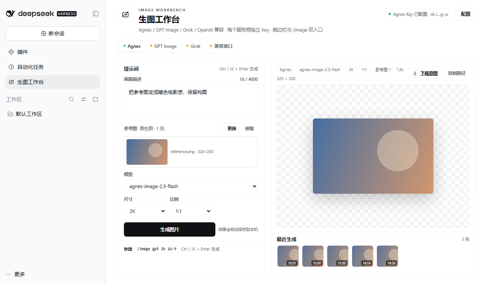
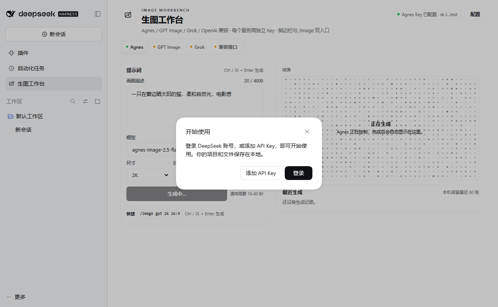

# dsh-image-studio · 生图工作台

DeepSeek Harness 的多服务商生图插件：**Agnes / OpenAI GPT Image / Grok Image / OpenAI 兼容**，每个服务商独立 Key；侧边栏一级页面 + `/image` 对话调用，复用 `open-storyboard-canvas` 的 Agnes 请求契约，并补齐 OpenAI Images 与 Grok Imagine 接口；支持文生图与最多 5 张参考图的图生图。

当前版本：**v0.15.3** · [CHANGELOG](CHANGELOG.md)



## 功能

- **五个服务商，各自独立 Key**：Agnes / GPT Image / Grok / MiniMax H3 / 自定义兼容接口，互不回退、互不覆盖；Key 只保存在本机插件目录。
- **侧边栏一级入口**：与「插件」「自动化任务」「上下文洞察」同级，点击直接打开完整面板。
- **右键复制**：大图或全屏图右键可「复制图片」「复制提示词」；复制图片会自动转 PNG 写入剪贴板，直接粘贴即可发送。提示词输入框右键也可复制提示词（有选区复制选区）。
- **完整面板**：服务商切换、模型/尺寸/比例/质量、提示词、参考图、Ctrl/⌘+Enter、**整块画布中心扩散的矩阵点动画（遮罩扩展到画布边界与四角）**、结果预览、**全屏看图与删除**、**下载原图**、复制路径、右键复制图片/提示词、`@参考图N`、相机控制、最近 80 张历史；静止/出图状态也用静态矩阵点，不再显示棋盘格；结果图按画布大小等比缩放，1:1 图不会把面板撑出窗口。
- **GPT 1K/2K/3K/4K + 比例**：自定义 GPT Image 2.5 模型尺寸只显示 1K/2K/3K/4K 四档，比例选择后自动算官方合法像素（宽高为 16 的倍数、比例 1:3–3:1、最长边≤3840、总像素 655,360–8,294,400）：`1K + 16:9 → 1280x720`、`2K + 16:9 → 2048x1152`、`4K + 16:9 → 3840x2160`；质量支持 `xhigh` / `max`。官方 gpt-image-1.x 仍只显示其支持的官方尺寸。
- **gpt-image-2.6（含动图）**：`gpt-image-2.6-sunburst` / `gpt-image-2.6-flare`，新增「复杂度」和「格式」；格式选 `gif` 时按每帧预算（1:1 = 512x512、16:9 = 896x512）生成动图，可设 2–16 帧、20–2000ms；GIF 仅文生图，参考图编辑用 png/jpeg/webp。`/image` 也支持 `--format gif --frames 12 --frame-ms 120`。
- **MiniMax H3 Image**：`MiniMax-H3-Image` / `MiniMax-H3-Image-Highspeed`，文生图和最多 16 张参考图编辑；按 `area`（1K/2K/4K）+ `aspect_ratio` 生成，编辑走 `/v1/images/edits` 的 `images[].image_url`，默认返回 `b64_json` PNG。
- **多端口预览**：图片与历史地址使用主 Web 服务的绝对 origin，不再跟随当前页面的 6355/6356 端口变成 401；对话内和工具卡都能直接预览。
- **Grok 取图**：`resolution` 使用小写 `1k/2k`；优先请求 `b64_json`，省掉“生成成功后再下载 URL”的第二次等待；下载 xAI 子域图片时带 Key，401/403 自动无 Key 重试，失败信息带 HTTP 状态和响应片段，方便定位。
- **GitHub 更新按钮**：标题栏「检查更新」读取 GitHub 最新 Release；有新版时执行 `git pull --ff-only`，本地有未提交改动会停止并提示，更新后重启 DSH 生效；非 Git 安装则显示「查看 vX」跳转 Release。
- **反向代理/远程入口**：默认仍只允许本机；profile 里显式设 `allowRemoteAccess: true` 后，交给 dsh `connection` 做 Host/Origin 和登录态检查，图片地址按当前入口生成，不再出现 `0.0.0.0` 图片。
- **多 IP 连接回退**：`api.one2api.top` 这类域名有多个 A 记录时，Node fetch 10 秒只试第一个地址；失败后自动用原生 HTTPS + `autoSelectFamily` 重试其余地址（JSON 和 multipart 都支持）。
- **等待与超时**：默认生图超时从 180 秒提高到 **300 秒**；图片 URL 回传单独给 **120 秒**预算，不会因为生成耗时占满总超时而在最后下载失败；支持“JSON 已完整但上游不关连接”时提前返回；面板显示已等待秒数，以及请求（响应头/响应体）、回传分段耗时。
- **图生图（最多 5 张参考图）**：提示词下方「添加参考图」，支持 PNG / JPEG / WebP，可点选或拖入多张，缩略图逐张可移除；Agnes 走 `extra_body.image[]`，OpenAI / 兼容走 `multipart /v1/images/edits`（重复 `image` 字段），Grok 走 JSON `/v1/images/edits` 的 `images[]`；DALL·E 3 不支持参考图。
- **`/image` 对话调用**：作为普通消息发送，模型调用 `image_studio_generate` 工具生成/修改；不注册 slash command，也不写 session 消息（避免缺少 `message.id` 的旧问题）。模型会把图片 Markdown 带回聊天内联显示，工具卡还提供「打开本地文件 / 打开原图」。输入框正常清空，可继续聊天；同一对话首条文生图，后续自动基于上一张修改，`--new` 重新生成。工具报错时模型不再自动重试（尤其是上游 HTTP 524 网关超时），先报告并询问是否重新生成，避免一次 30 秒的图拖成 5 分钟。
- **模型嗅探**：配置 Key 后在「生图设置」点「嗅探模型」，用已保存的 Key 拉取服务商 `/v1/models`；结果可多选，只有勾选的模型保存后会进入主面板下拉，图像模型带「图像」标记。
- **与 dsh 主题融合**：使用 `--dsw-alias-*`、`--dsh-frame-top-clearance` 等实时 token。
- **明确失败**：未配置 / 401 / 402 / 429 / 超时 / 网络 / 无图片数据分别有可执行提示；上游 404 “Parameter error” 会被识别为中转渠道/参数问题，而不是本地接口路径错误；内容审核会单独提示。



*生成中：矩阵点铺满整块画布，中心向外扩散波动，遮罩扩展到画布边界与四角；左右卡片等高，下方「最近生成」在同一屏内可见。*

## 服务商

| id | 面板名称 | 默认 Base URL | 默认模型 | 参数形态 | 图生图 |
|---|---|---|---|---|---|
| `agnes` | Agnes | `https://apihub.agnes-ai.cn` | `agnes-image-2.5-flash` | `size` 档位 1K–4K + `ratio` | 同 generations，`extra_body.image` |
| `openai` | OpenAI GPT Image | `https://api.openai.com` | `gpt-image-1.5` | 像素 `size` + `quality`；DALL·E 3 自动切换尺寸/质量 | `multipart /v1/images/edits`（DALL·E 3 不支持） |
| `grok` | Grok Image | `https://api.x.ai` | `grok-imagine-image-2.0` | `aspect_ratio` + `resolution`（1K/2K）+ `quality` | JSON `/v1/images/edits`，`images[]` |
| `openai-compatible` | OpenAI 兼容 | `https://api.example.com` | `gpt-image-1` | 自己填 Base URL / 接口路径 / 模型，标准 Images body | `multipart /v1/images/edits` |

OpenAI 兼容档可接任意 `POST /images/generations` 风格的中转/聚合器；模型名、尺寸、接口路径都可以在面板里改。图生图接口按生成路径把 `generations` 替换为 `edits`（默认 `/v1/images/edits`），Base URL 不变。

## 安装

> **包名注意**：本插件的包名是 `dsh-image-studio-workbench`，仓库名才是 `dsh-image-studio`。
> npm 上另有一个同名的 `dsh-image-studio@0.1.x`（作者 meliodascz89，带 Stable Diffusion worker），**不是这个插件**，装错会出现「与当前 DSH 不兼容」。
> 请用下面的 GitHub 方式安装，或从插件市场的 `david-zdw/dsh-image-studio` 条目安装。

```powershell
# 直接装 GitHub 版本（推荐，不用 clone）
dsh plugin --profile desktop add github:david-zdw/dsh-image-studio

# 或者 clone 下来用本地 link 安装
git clone https://github.com/david-zdw/dsh-image-studio.git

# 在 DSH profile 中安装这个本地包（路径换成你的 clone 目录）
dsh plugin --profile desktop add link:D:/path/to/dsh-image-studio
# macOS / Linux:
# dsh plugin --profile desktop add link:/path/to/dsh-image-studio
```

也可以在 DSH 插件管理器里选择 `install_bundle`，目标目录指向 clone 下来的仓库。

安装后侧边栏出现「生图工作台」。如果当前窗口是在安装前启动的，重新加载窗口/重启 DSH 一次即可。卸载：

```powershell
dsh plugin --profile desktop remove dsh-image-studio-workbench
```

## 更新

当前版本 `v0.15.3`。更新后顶栏会显示 `IMAGE WORKBENCH · v0.15.3`，可以用它确认是否生效。

### 本地 link 安装（推荐）

```powershell
cd D:/path/to/dsh-image-studio
git fetch --tags
git pull --ff-only

# 或固定到某个版本
git checkout v0.15.3
```

然后重启 DSH，或在插件管理器里禁用/启用一次「生图工作台」。HMR 只用于开发；普通用户重启最稳。

### 插件管理器安装

在插件管理器里更新/重装 `dsh-image-studio-workbench`，目标仍指向同一个 clone 目录。也可以走 profile 的 pnpm：

```powershell
dsh plugin --profile desktop update dsh-image-studio-workbench
```

注意：`dsh plugin` 只是把参数转发给 pnpm。如果当初是 `link:` 安装，`pnpm update` 不会帮你拉取 git 更新，仍然要先 `git pull`。

### 更新不会丢配置

Key、Base URL、模型、历史都在：

```text
$DSH_HOME/image-studio/
```

更新/重装插件不会清空这个目录。不要为了更新去删除它。

## 发布（GitHub-only）

1. 修改 `package.json` 的 `version`；
2. 提交并推送 `main`：`git push origin main`；
3. 可选但推荐：打 tag 并创建 Release：`git tag -a vX.Y.Z -m vX.Y.Z && git push origin vX.Y.Z`，再 `gh release create vX.Y.Z`。

插件内「检查更新」会比较 `main/package.json` 和最新 Release，取较高版本；市场更新跟随 GitHub 提交，不需要 npm。


## 使用

1. 点击侧边栏「生图工作台」。
2. 选择服务商页签（Agnes / GPT Image / Grok / 兼容接口）。
3. 点右上角「配置」，给**当前服务商**填 Key、Base URL、模型、默认参数；Agnes 配置里有「获取 Agnes Key」直达平台。保存 Key 后可点「嗅探模型」，从服务商 `/v1/models` 拉取列表；勾选需要的模型（可多选）后保存，主面板下拉只显示勾选的模型。
4. 需要图生图时，在提示词下方点「添加参考图」，可选择或拖入多张 PNG / JPEG / WebP（最多 5 张）；缩略图会显示在参考图区域，可逐张移除。
5. 输入提示词，点「生成图片」。
6. 生成后结果右上角有全屏图标、**删除**、**下载原图**（PNG/JPEG/WebP）和「复制路径」；点全屏图标或图片本身可全屏查看（Esc/点背景关闭，全屏内也可删除/下载），历史缩略图右上角也可删除。

或直接发送：

```text
# 第一条：文生图
/image gpt 2k 16:9 一只戴宇航头盔的橘猫

# 同一对话第二条：自动基于上一张修改
/image 把背景改成雨夜霓虹街道，保留橘猫和头盔

# 同一对话想重新文生图：加 --new
/image --new agnes 1k 1:1 一只在窗边晒太阳的猫

# 也支持显式参数（老写法）
/image --provider openai --size 1024x1024 --quality high 一只戴宇航头盔的橘猫
```

`/image` 不是 DSH 斜杠命令，而是消息里的调用语法；发送后由模型调用 `image_studio_generate` 工具。工具返回的图片会留在当前对话里，不会跳到工作台；输入框会像普通消息一样清空，之后可以继续聊天。需要下载原图、看历史或换更多参数时再点侧边栏「生图工作台」。

提示：GPT Image 没有 2K/4K 档，`gpt 2k 16:9` 会映射为 `1536x1024`（竖图为 `1024x1536`，方形为 `1024x1024`）；Grok/Agnes 保留原生 2K 档。

简写规则：**开头的服务商/尺寸/比例可以任意顺序写**，遇到第一个不认识的词就开始当提示词。`gpt 2k 16:9`、`grok 2k 9:16`、`agnes 1k 1:1`、`2k 16:9` 都行。

`--provider` 支持 `agnes`、`openai`（别名 `gpt`）、`grok`、`openai-compatible`（别名 `compatible`/`custom`）。

`/image` 工具支持对话内连续修改：第一条生成，第二条起自动把上一张作为参考图；`/image --new <提示词>` 强制重新文生图。

## 数据位置

| 路径 | 内容 |
|---|---|
| `$DSH_HOME/image-studio/credentials.json` | `{ "keys": { "agnes": "...", "openai": "...", "grok": "...", "openai-compatible": "..." } }` |
| `$DSH_HOME/image-studio/config.json` | `defaultProvider` 与每个服务商的 Base URL / 模型 / 默认参数 |
| `$DSH_HOME/image-studio/history.json` | 最近 80 条生成元数据（含 provider） |
| `$DSH_HOME/image-studio/outputs/` | 生成的 PNG/JPEG/WebP/GIF |
| 参考图 | 只在浏览器内存中参与当前请求；不写入 history、outputs 或任何配置文件 |

`$DSH_HOME` 默认是 `~/.dsh`（Windows：`C:\Users\<你>\.dsh`）。

## 配置字段

顶层：

| 字段 | 默认值 | 说明 |
|---|---|---|
| `enabled` | `true` | 总开关 |
| `defaultProvider` | `agnes` | `/image` 未写 `--provider` 时使用；点击面板服务商页签会自动更新 |
| `providers.<id>.*` | 见下表 | 每个服务商的独立配置 |
| `allowRemoteAccess` | `false` | 开启后允许经反向代理 / 远程入口访问；授权交给 dsh 的 `connection` 服务（Host/Origin + 登录态） |
| `allowedHostnames` | `[]` | `connection` 服务不可用时的兜底 Host 白名单；端口会被忽略 |

每个 `providers.<id>`：

| 字段 | 说明 |
|---|---|
| `baseUrl` | 根地址；不能带查询参数 |
| `endpointPath` | 默认 `/v1/images/generations`，兼容中转可改 |
| `model` | 默认模型 |
| `size` | 默认尺寸；Agnes/Grok 用 1K/2K，OpenAI 用 1024x1024 等 |
| `ratio` | 仅 Agnes/Grok 使用 |
| `quality` | 仅 OpenAI/Grok 使用 |

Key 的环境变量兜底（文件 Key 优先）：

| 服务商 | 环境变量 |
|---|---|
| Agnes | `DSH_IMAGE_STUDIO_AGNES_API_KEY`，兼容旧 `DSH_IMAGE_STUDIO_API_KEY` |
| OpenAI | `DSH_IMAGE_STUDIO_OPENAI_API_KEY` |
| Grok | `DSH_IMAGE_STUDIO_GROK_API_KEY` |
| 兼容接口 | `DSH_IMAGE_STUDIO_OPENAI_COMPATIBLE_API_KEY` |

Key 优先级：**`credentials.json` 中该服务商的 Key > 该服务商环境变量 > 无**；不会读取其他服务商的 Key，也不会读取 dsh 的模型凭据。

### 反向代理与远程入口

默认只服务回环连接（`127.0.0.1` / `::1`），带 `X-Forwarded-For` 的请求一律拒绝。要让 `https://dsh.example.com` 这类入口也能用，在 profile patch 中显式开启：

```yaml
- id: image-studio
  name: dsh-image-studio-workbench
  config:
    allowRemoteAccess: true
    # 可选：仅在 connection 服务不可用时作为兜底
    allowedHostnames:
      - dsh.example.com
      - 203.0.113.7:3080
```

开启后每个请求交给 dsh 的 `connection.requestRejection()`——和 dsh 其他路由同一套 Host/Origin 围栏和浏览器登录态检查，未登录返回 401。没有该服务时退回 `allowedHostnames`，名单外仍然 403。

图片地址按**当前请求的入口**生成（域名、tailnet 名、裸 IP 各用各的）；没有请求上下文时用 dsh 的对外地址（`--public-url`），再拿不到就退回相对路径，不会出现 `http://0.0.0.0:3080/...` 这种浏览器加载不了的地址。

## 开发与测试

```powershell
# 四服务商宿主冒烟（mock 上游）：Key 隔离、请求体、image_studio_generate、文件路由
$env:DSH_HOME='D:\deepseek\_smoke-home'
node scripts/smoke-host.mjs
```

设计、请求映射、Key 存储、两条调用链路和改动点见 [docs/design.md](docs/design.md)。

## 备注

- GPT Image 使用标准 `/v1/images/generations` JSON body；参考图编辑走 `/v1/images/edits` multipart，支持 1–5 张（重复 `image` 字段）。
- Grok Imagine 使用 `grok-imagine-image-2.0` 的 `aspect_ratio` + `resolution` + `quality`；如果 xAI 改了参数，Base URL/模型可改，body 变更需要同步 `lib/providers.js`。
- OpenAI 兼容档的 `auto` 尺寸会省略 `size` 字段，尽量兼容不同中转。
