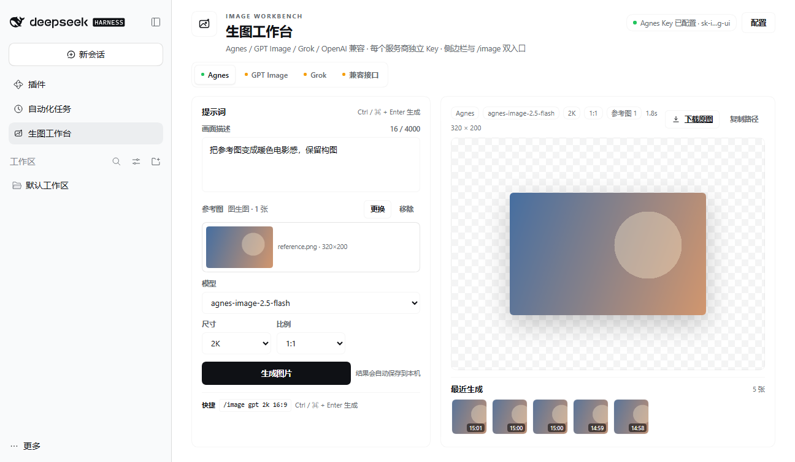
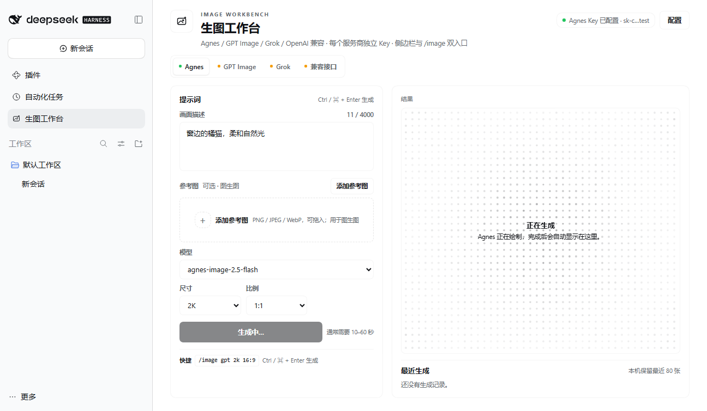

# dsh-image-studio · 生图工作台

DeepSeek Harness 的多服务商生图插件：**Agnes / OpenAI GPT Image / Grok Image / OpenAI 兼容**，每个服务商独立 Key；侧边栏一级页面 + `/image` 斜杠命令，复用 `open-storyboard-canvas` 的 Agnes 请求契约，并补齐 OpenAI Images 与 Grok Imagine 接口；支持文生图与参考图图生图。



## 功能

- **四个服务商，四个独立 Key**：互不回退、互不覆盖；Key 只保存在本机插件目录，不写入 dsh 模型凭据或其他插件配置。
- **侧边栏一级入口**：与「插件」「自动化任务」「上下文洞察」同级，点击直接打开完整面板。
- **完整面板**：服务商切换、模型/尺寸/比例/质量、提示词、参考图、Ctrl/⌘+Enter、**整块画布中心扩散的矩阵点动画（遮罩扩展到画布边界与四角）**、结果预览、**下载原图**、复制路径、最近 80 张历史。
- **图生图**：提示词下方「添加参考图」，支持 PNG / JPEG / WebP，点选或拖入；Agnes 走 `extra_body.image`，OpenAI / 兼容走 `multipart /v1/images/edits`，Grok 走 JSON `/v1/images/edits` 的 `images[]`；DALL·E 3 不支持参考图。
- **`/image` 命令**：`/image --provider openai --size 1024x1024 --quality high <提示词>`，直接在对话命令面出图。
- **与 dsh 主题融合**：使用 `--dsw-alias-*`、`--dsh-frame-top-clearance` 等实时 token。
- **明确失败**：未配置 / 401 / 402 / 429 / 超时 / 网络 / 无图片数据分别有可执行提示。



*生成中：矩阵点铺满整块画布，中心向外扩散波动，遮罩扩展到画布边界与四角；左右卡片等高，下方「最近生成」在同一屏内可见。*

## 服务商

| id | 面板名称 | 默认 Base URL | 默认模型 | 参数形态 | 图生图 |
|---|---|---|---|---|---|
| `agnes` | Agnes | `https://apihub.agnes-ai.cn` | `agnes-image-2.5-flash` | `size` 档位 1K–4K + `ratio` | 同 generations，`extra_body.image` |
| `openai` | OpenAI GPT Image | `https://api.openai.com` | `gpt-image-1.5` | 像素 `size` + `quality`；DALL·E 3 自动切换尺寸/质量 | `multipart /v1/images/edits`（DALL·E 3 不支持） |
| `grok` | Grok Image | `https://api.x.ai` | `grok-imagine-image-2.0` | `aspect_ratio` + `resolution`（1K/2K）+ `quality` | JSON `/v1/images/edits`，`images[]` |
| `openai-compatible` | OpenAI 兼容 | `https://api.example.com` | `gpt-image-1` | 自己填 Base URL / 接口路径 / 模型，标准 Images body | `multipart /v1/images/edits` |

OpenAI 兼容档可接任意 `POST /images/generations` 风格的中转/聚合器；模型名、尺寸、接口路径都可以在面板里改。图生图接口按生成路径把 `generations` 替换为 `edits`（默认 `/v1/images/edits`），Base URL 不变。

## 安装

```powershell
git clone https://github.com/david-zdw/dsh-image-studio.git

# 在 DSH profile 中安装这个本地包（路径换成你的 clone 目录）
dsh plugin --profile desktop add link:D:/path/to/dsh-image-studio
# macOS / Linux:
# dsh plugin --profile desktop add link:/path/to/dsh-image-studio
```

也可以在 DSH 插件管理器里选择 `install_bundle`，目标目录指向 clone 下来的仓库。

安装后侧边栏出现「生图工作台」。如果当前窗口是在安装前启动的，重新加载窗口/重启 DSH 一次即可。卸载：

```powershell
dsh plugin --profile desktop remove dsh-image-studio
```

## 使用

1. 点击侧边栏「生图工作台」。
2. 选择服务商页签（Agnes / GPT Image / Grok / 兼容接口）。
3. 点右上角「配置」，给**当前服务商**填 Key、Base URL、模型、默认参数。
4. 需要图生图时，在提示词下方点「添加参考图」，选择或拖入一张 PNG / JPEG / WebP；缩略图会显示在参考图区域，可随时更换/移除。
5. 输入提示词，点「生成图片」。
6. 生成后结果右上角有「下载原图」（PNG/JPEG/WebP）和「复制路径」；参考图生成的结果会带「参考图 1」标记。

或直接发送：

```text
/image gpt 2k 16:9 一只戴宇航头盔的橘猫
/image grok 2k 9:16 雨夜霓虹街道
/image agnes 1k 1:1 电影感棚拍
/image 2k 16:9 默认服务商出图

# 也支持显式参数（老写法）
/image --provider openai --size 1024x1024 --quality high 一只戴宇航头盔的橘猫
```

提示：GPT Image 没有 2K/4K 档，`gpt 2k 16:9` 会映射为 `1536x1024`（竖图为 `1024x1536`，方形为 `1024x1024`）；Grok/Agnes 保留原生 2K 档。

简写规则：**开头的服务商/尺寸/比例可以任意顺序写**，遇到第一个不认识的词就开始当提示词。`gpt 2k 16:9`、`grok 2k 9:16`、`agnes 1k 1:1`、`2k 16:9` 都行。

`--provider` 支持 `agnes`、`openai`（别名 `gpt`）、`grok`、`openai-compatible`（别名 `compatible`/`custom`）。

`/image` 命令目前是文生图；图生图请用面板里的「添加参考图」。

## 数据位置

| 路径 | 内容 |
|---|---|
| `$DSH_HOME/image-studio/credentials.json` | `{ "keys": { "agnes": "...", "openai": "...", "grok": "...", "openai-compatible": "..." } }` |
| `$DSH_HOME/image-studio/config.json` | `defaultProvider` 与每个服务商的 Base URL / 模型 / 默认参数 |
| `$DSH_HOME/image-studio/history.json` | 最近 80 条生成元数据（含 provider） |
| `$DSH_HOME/image-studio/outputs/` | 生成的 PNG/JPEG/WebP/GIF |
| 参考图 | 只在浏览器内存中参与当前请求；不写入 history、outputs 或任何配置文件 |

`$DSH_HOME` 默认是 `~/.dsh`（Windows：`C:\Users\<你>\.dsh`）。

## 配置字段

顶层：

| 字段 | 默认值 | 说明 |
|---|---|---|
| `enabled` | `true` | 总开关 |
| `defaultProvider` | `agnes` | `/image` 未写 `--provider` 时使用；点击面板服务商页签会自动更新 |
| `providers.<id>.*` | 见下表 | 每个服务商的独立配置 |

每个 `providers.<id>`：

| 字段 | 说明 |
|---|---|
| `baseUrl` | 根地址；不能带查询参数 |
| `endpointPath` | 默认 `/v1/images/generations`，兼容中转可改 |
| `model` | 默认模型 |
| `size` | 默认尺寸；Agnes/Grok 用 1K/2K，OpenAI 用 1024x1024 等 |
| `ratio` | 仅 Agnes/Grok 使用 |
| `quality` | 仅 OpenAI/Grok 使用 |

Key 的环境变量兜底（文件 Key 优先）：

| 服务商 | 环境变量 |
|---|---|
| Agnes | `DSH_IMAGE_STUDIO_AGNES_API_KEY`，兼容旧 `DSH_IMAGE_STUDIO_API_KEY` |
| OpenAI | `DSH_IMAGE_STUDIO_OPENAI_API_KEY` |
| Grok | `DSH_IMAGE_STUDIO_GROK_API_KEY` |
| 兼容接口 | `DSH_IMAGE_STUDIO_OPENAI_COMPATIBLE_API_KEY` |

Key 优先级：**`credentials.json` 中该服务商的 Key > 该服务商环境变量 > 无**；不会读取其他服务商的 Key，也不会读取 dsh 的模型凭据。

## 开发与测试

```powershell
# 四服务商宿主冒烟（mock 上游）：Key 隔离、请求体、/image、文件路由
$env:DSH_HOME='D:\deepseek\_smoke-home'
node scripts/smoke-host.mjs
```

设计、请求映射、Key 存储、两条调用链路和改动点见 [docs/design.md](docs/design.md)。

## 备注

- GPT Image 使用标准 `/v1/images/generations` JSON body；参考图编辑走 `/v1/images/edits` multipart，当前面板暂未开放。
- Grok Imagine 使用 `grok-imagine-image-2.0` 的 `aspect_ratio` + `resolution` + `quality`；如果 xAI 改了参数，Base URL/模型可改，body 变更需要同步 `lib/providers.js`。
- OpenAI 兼容档的 `auto` 尺寸会省略 `size` 字段，尽量兼容不同中转。
